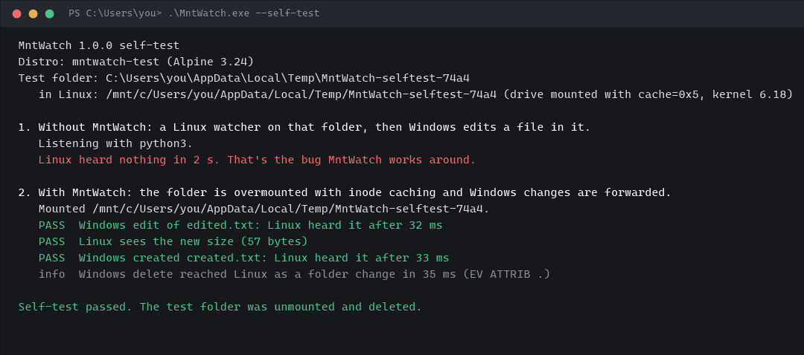

<p align="center"></p>

<h1 align="center">MntWatch</h1>

<p align="center"><b>Hot reload for WSL 2 projects on /mnt/c. MntWatch makes Linux file watchers (Vite, webpack, nodemon, Python reloaders, <code>fs.watch</code>, inotify) see the files you edit in Windows, without polling and without moving your code into the Linux filesystem.</b></p>

<p align="center">
  <a href="https://github.com/BoazCohenJ/MntWatch/releases/latest/download/MntWatch.exe"><b>⬇ Download MntWatch.exe</b></a> ·
  <a href="https://boazcohenj.github.io/MntWatch/">Website</a> ·
  <a href="#how-it-works">How it works</a> ·
  <a href="#limits-read-these">Limits</a> ·
  <a href="#faq">FAQ</a>
</p>

You keep a project on `C:\`, edit it in a Windows editor, and run `npm run dev` in WSL 2. You save, and nothing reloads. inotify, the Linux API every file watcher is built on, never fires for files under `/mnt/c`. It's been [microsoft/WSL#4739](https://github.com/microsoft/WSL/issues/4739) since 2019 (660+ 👍), and the usual answers are "turn on polling in every tool" or "move your code into the Linux filesystem".

MntWatch is a small Windows tray app. Point it at a project folder and Linux watchers in that folder start hearing about changes, typically within 10 to 30 ms of the save:



## Features

- **Edits, new files and atomic saves made in Windows reach Linux watchers** as inotify events, with no polling.
- **Changes made from Linux fire too.** It turns out inotify on `/mnt/c` is broken for *every* writer, Linux programs included (see below); inside a MntWatch folder, Linux-side writes fire normally again.
- **Only the folders you pick are touched.** Everything else under `/mnt/c` stays exactly as WSL set it up, and a folder goes back to normal the moment MntWatch stops (even if it's killed).
- **Never starts WSL by itself.** It waits until your distro is running, attaches, and detaches again on `wsl --shutdown`.
- **Built-in self-test.** `MntWatch.exe --self-test` (or *Run self-test* in the tray) first reproduces the bug on a temporary folder, then shows the fix with timings.
- **One small exe**, about 100 KB, plus a short shell script it runs in your distro. No driver, no service, nothing to install in Linux, nothing sent anywhere. Runs on the .NET Framework 4.8 that ships with Windows 10 and 11. MIT licensed.

## Install

1. Download [`MntWatch.exe`](https://github.com/BoazCohenJ/MntWatch/releases/latest/download/MntWatch.exe) from the [latest release](https://github.com/BoazCohenJ/MntWatch/releases/latest), put it somewhere permanent and run it.
2. Click the tray icon → **Add folder...** and pick your project (for example `C:\dev\my-app`).
3. **Restart your dev server once** (and `cd` back into the folder in open shells). Programs that were already inside the folder keep the old view until they restart.

Optional: *Start with Windows* in the same menu, and *WSL distro* if you don't want your default distro. Prefer a terminal? `MntWatch.exe --run C:\dev\my-app` does the same until Ctrl+C.

The exe isn't code-signed yet, so SmartScreen may show "Windows protected your PC". Click **More info → Run anyway**, or build it yourself (below). Release builds are compiled by [GitHub Actions](.github/workflows/build.yml) from the tagged source and come with a SHA-256 checksum.

**Requirements:** WSL 2 with a current kernel (`wsl --update`; MntWatch tells you if yours is too old to accept the cache flags it needs), and a folder on a local drive that WSL mounts (the usual `/mnt/c`, `/mnt/d`). Any distro works: the helper only needs `sh`, `stat`, `chmod`, `xargs`, `awk` and `mount`.

## How it works

The bug isn't really about Windows. WSL mounts your drives over 9p with `cache=0x5`, a mode where the Linux kernel makes a **new inode every time a file is looked up**. An inotify watch is attached to an inode, so the watch is on one inode while every later read or write goes through a fresh one. No event ever reaches it, whoever made the change. ([Here's a 2026 repro](https://github.com/microsoft/WSL/issues/4739#issuecomment-4526928527) showing the same thing from inside Docker.)

MntWatch does two things for each folder you add:

1. **Overmounts just that folder** inside your distro with the same drvfs settings (owner, permissions, `metadata`, case handling) plus one extra cache bit, `0x2`, which makes the kernel keep one inode per file. With that alone, inotify works for changes made from Linux.
2. **Forwards Windows changes.** The exe watches the folder with Windows' own change notifications. For every changed path, a helper in the distro writes the file's own mode back to it (`chmod` to the mode it already has). That makes Linux refresh the file's size and timestamps from Windows and raise `IN_ATTRIB`, which watchers report as a change. Nothing changes on the Windows side.

| Windows change | What Linux watchers see |
|---|---|
| Edit or save | A change on that file (Node `fs.watch`: `change`; watchdog: `modified`) |
| New file | A change on the file and its folder; `fs.watch` reports it as new |
| Atomic save (temp file + rename) | A change on the file and its folder |
| Delete | A change on the folder (there's no way to fake `IN_DELETE`) |
| New folder | A change on its parent; see the limits below |

The helper ([`helper.sh`](src/MntWatch/helper.sh), about 90 lines) runs as root through `wsl.exe --user root`, because mounting needs it. It's sent over stdin each time MntWatch connects, and it unmounts everything it mounted as soon as MntWatch goes away.

## Limits (read these)

- **Linux sees new sizes as soon as MntWatch nudges them, not before.** With the extra cache bit, Linux keeps a file's size and timestamps until it's told to refresh them. MntWatch does that for every change Windows reports, usually 5 to 30 ms after the write. A Linux program that appends to a file in that window can overwrite what Windows just appended. In practice that only matters for two programs, one on each side, writing the same file at the same moment. Avoid that inside a watched folder. Reading files is fine: an `open()` always returns the current content.
- **Deletes show up as a folder change**, not as a delete. Dev servers that rescan on folder changes (Vite, webpack, anything on chokidar or Node's recursive `fs.watch`) handle this.
- **Folders created from Windows** are picked up by watchers that rescan (Node's `fs.watch`, chokidar). Watchers that only start watching a new subfolder when they get a real `IN_CREATE` (Python watchdog, Rust `notify`/watchfiles, Go fsnotify) won't see files inside a folder created from Windows until they restart. Files in existing folders are fine.
- **Go tools that ignore `Chmod` events** (some hot-reloaders do) won't react to Windows edits. Check their config for a "chmod"/"attrib" option.
- **Each change Linux makes is reported twice**: the real event, then one from MntWatch's nudge a few ms later. Watchers that compare timestamps (chokidar) drop the second one. Others may reload twice.
- **Docker Desktop bind mounts aren't covered.** Containers see the folder through Docker's own distro, not yours.
- **Not for `\\wsl$` or network drives.** Only local drives that WSL mounts.
- **Keeps your distro running** while it's attached, since its helper is a process in it. Pause it from the tray to let WSL shut down when idle.

## FAQ

**Why not just poll (`CHOKIDAR_USEPOLLING=1`, `WATCHPACK_POLLING=true`, `usePolling`)?**
Polling works, but it costs CPU on big trees, adds a delay, and has to be set up in every tool, often in every project. With MntWatch, the default inotify mode works.

**Why not move the project into the Linux filesystem (`~/project`)?**
That's Microsoft's advice and the fastest setup, and if it works for you, do it. MntWatch is for when the files have to stay on Windows: Windows-only tools, a Windows editor without remote mode, sync folders, backups, or a repo shared with Windows builds.

**Is it safe? It runs a script as root.**
The script is in this repo and is sent fresh each time. It only runs `mount`/`umount` on the folders you added, `stat` and `chmod` (same mode back, symlinks skipped) on paths Windows reported, and `find` when Windows reports lost events. It never writes file contents and never deletes anything. The overmount is undone when MntWatch exits or is killed. A Linux program sitting *inside* the folder at that moment keeps the detached view until it exits; new shells get the normal mount immediately.

**Does it work with Vite / webpack / nodemon / Next.js / uvicorn / Django?**
Node's `fs.watch` (which chokidar, and so Vite, webpack and nodemon, are built on) and Python's watchdog were tested and get every edit. The specific dev servers weren't tested one by one yet. If yours doesn't reload, run the self-test and open an issue with its output.

**What did you test on?**
Windows 11, WSL 2.7.13, kernel 6.18.33.2, an Alpine 3.24 distro, Node 24 `fs.watch` (recursive) and Python watchdog: single edits, new files and folders, atomic saves, deletes, 3,000- and 20,000-file bursts (every file arrived), Linux-side writes (no feedback loop), `metadata` mounts, symlinks, and killing MntWatch with Task Manager (folder unmounted). Not yet tested: Ubuntu or Debian distros, and kernels older than 6.18 (older ones that list `cache=mmap` instead of `cache=0x…` are refused with a "run wsl --update" message).

## Command line

```
MntWatch.exe                      Start in the tray
MntWatch.exe --run <folder>...    Bridge folders from a console until Ctrl+C (--distro <name>, --verbose)
MntWatch.exe --self-test          Reproduce the bug on a temp folder, then show the fix (--distro <name>)
MntWatch.exe --distros            List WSL distros, the default and which are running
```

Settings live in `%LOCALAPPDATA%\MntWatch\settings.ini` (one `folder=` line per folder), and the log is next to them.

## Build from source

```
dotnet test tests/MntWatch.Tests -c Release
dotnet build src/MntWatch -c Release
```

The exe lands in `src/MntWatch/bin/Release/net48/`. The planner (`Planner.cs`) and mount handling (`Drvfs.cs`) are free of I/O and unit-tested; `SelfTest.cs` is the end-to-end check against a real distro.

## Why this exists

"Hot reload doesn't work in WSL 2 on `/mnt/c`" is one of the longest-running WSL complaints: [microsoft/WSL#4739](https://github.com/microsoft/WSL/issues/4739), open since December 2019 with 660+ reactions, 180 comments and new reports in 2026, plus reports in other projects' trackers such as [Bun](https://github.com/oven-sh/bun/issues/4335) and [Zed](https://github.com/zed-industries/zed/issues/51340). There was no standalone fix, so I built one.

## License

[MIT](LICENSE). Not affiliated with Microsoft.
